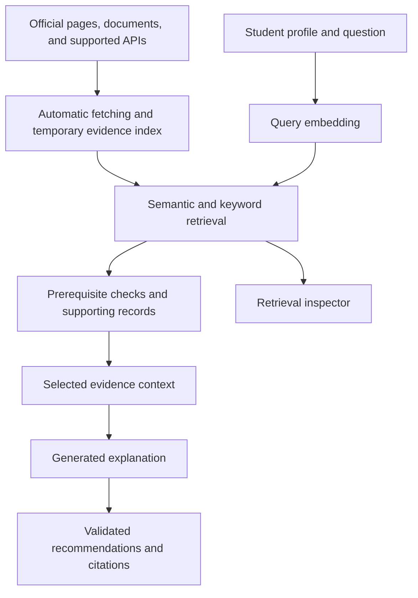

# RAG Design

The advisor uses retrieval-augmented generation to explain recommendations using evidence retrieved from official academic sources and relevant learning and career sources. The target is automatic source retrieval with a temporary cache, without requiring a manually maintained course database. Updating the retrieved evidence changes the information available to the model without retraining it.

The current prototype reads a bundled, reviewed collection. Runtime source retrieval is planned work. Saved reference files support development and verification rather than supplying the deployed app's only source of information.

## Pipeline

The first working version needs real retrieval, a real generation call using the retrieved evidence, and source links. A search screen alone is an intermediate step.

## Obtaining source material

Resolve the student's program, catalog edition, and requested topic before fetching. Start with a small configured set of official sources. Discover linked course entries and sample plans through supported public pages, exports, or documented APIs where available. Source access and parsing must be verified for each connector. Do not assume a search result or page footer contains the requested information.

When a student submits a roadmap update or opportunity search, aim to check the relevant sources at that time. Revalidate cached content when the source supports it, otherwise fetch the required material within provider limits. Ordinary interface rerenders should not trigger repeated requests. Extract the relevant fields and passages, validate source identity and edition, and build evidence chunks and an in-memory index for the bounded candidate set. Reuse unchanged content and embeddings. RAG requires retrievable evidence during the request, not a permanent vector database.

If a persistent content database is introduced, it must also refresh automatically on a configurable schedule. Background updates supplement checks during use. They do not replace them. Record the last successful source check separately from the last content download, and update dependent evidence when content changes. A source that has not changed does not need to be embedded again.

Keep the source URL, page or section, retrieval time, content hash, and validation state with each chunk. A changed hash invalidates dependent embeddings and answers. Current retrieval must respect a student's catalog edition rather than silently switching them to the newest degree requirements.

If retrieval or revalidation fails, label any cached evidence with its last successful source check or report that the information is unavailable. Do not present a failed refresh or a saved development file as current verification. Unresolved academic conditions stay unknown even when the descriptive page was fetched successfully.

## Preparing the active collection

1. Collect official source information and record its catalog edition and retrieval date.
2. Normalize the record, preserving the original prerequisite wording.
3. Validate extracted descriptions and keep academic rules unknown until their interpretation is supported. Changed or unsupported rule formats need review.
4. Split the content into evidence chunks with stable IDs, source links, and hashes.
5. Embed each chunk separately and build the keyword index from the same text.
6. Keep a manifest linking vector rows to chunk IDs and the model configuration, in memory or in a rebuildable cache.

Start with one chunk per short course description. Keep prerequisite conditions intact. Remove navigation and repeated footer text.

Rebuild affected chunks when sources change. A different embedding model or incompatible configuration requires a new index.

## Retrieval

Start with semantic retrieval. Add BM25 and hybrid ranking after the first full RAG interaction works.

| Setting | Initial choice |
| --- | --- |
| Embedding model | Gemini Embedding 2, subject to access testing |
| Input | Text |
| Dimensions | 768 |
| Candidate pool | Up to 20 results per method |
| Context | Up to eight chunks, with a 16,000-character evidence limit |
| Display | Up to five next steps |
| Hybrid ranking | Reciprocal Rank Fusion, constant 60 |
| Generation | One call per submitted roadmap request |

These are starting settings to evaluate.

The initial implementation includes all three retrieval methods. Provider access and live answer quality remain to be verified. The context limit applies to evidence text, while profile lengths and generated output are bounded separately.

Normalize vectors and use cosine similarity. For hybrid retrieval, combine ranks rather than adding raw BM25 and cosine values. RRF adds 1 / (60 + rank) for each list containing a chunk. Ranks start at one.

For the planned embedding adapter, use the documented retrieval query/document formats and confirm that the returned vectors match the number of chunks. Keep model ID, dimensions, formatting, normalization, and chunk order in the index manifest.

Deduplicate course cards when several chunks refer to the same course. Retrieve prerequisite evidence by exact identity from the full collection, even when it falls outside the relevance cutoff. Preserve alternatives in OR requirements.

## Generation

The model receives:

- The student's goal and relevant background.
- Selected course, resource, and career-mapping evidence.
- Application-computed prerequisite results.
- Allowed recommendation IDs and a defined response structure.

The explanation should connect the evidence to the student's goal. It should distinguish a suggested learning connection from an explicit catalog fact.

Every factual claim needs supporting evidence from the supplied context. Missing information should produce a limitation or focused clarification. Retrieved text is source material, not an instruction channel.

The application supplies course titles, credits, prerequisite badges, and URLs from stored records. The model generates explanatory text. Citations resolve through stored evidence IDs.

## Validation and failures

Check that recommendation IDs were allowed, citation IDs were actually supplied, and every citation resolves to a known source. Keep generated output separate from application-owned academic status.

These checks establish reference integrity. Whether a sentence follows from its source still needs evaluation.

| Situation | App behavior |
| --- | --- |
| Evidence is insufficient | Explain the coverage limit or ask for clarification |
| Academic information is missing or conflicting | Keep the affected condition unknown |
| Embedding service fails | Offer a labeled keyword fallback where possible |
| Generation fails | Retain source cards and rule results, with the explanation unavailable |
| A citation or record ID is invalid | Reject the affected generated output |
| Model and index do not match | Load a compatible index or rebuild |

Keyword retrieval followed by generation is still RAG, but does not demonstrate the planned neural retrieval path. A retrieval-only fallback does not complete the first RAG milestone.

## Inspection and timing

Show the exact evidence passed to the model, retrieved ranks, similarity scores, and source excerpts. Use a fixed PCA projection for the embedding map and rank in the original vector space. Similarity is not a probability.

Record data/model/prompt versions, selected evidence IDs, validation results, cache state, and timings for embedding, retrieval, generation, and the total request. Keep credentials and full personal histories out of routine logs.
